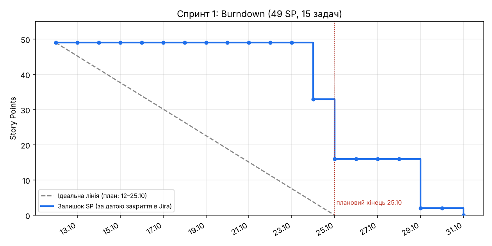
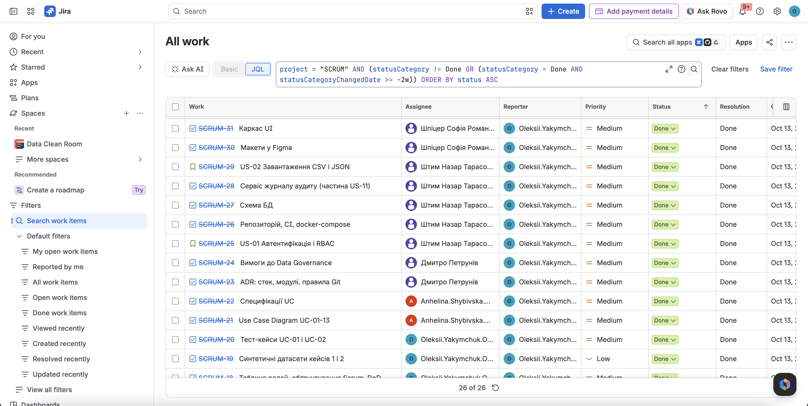
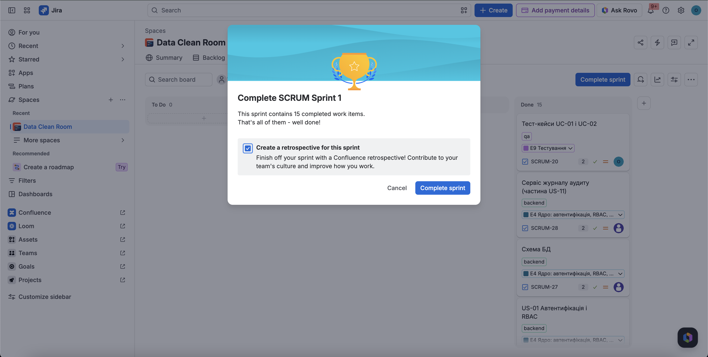

# Спринт 1: Review, Retrospective, Burndown, Velocity

Проєкт: Data Clean Room · Jira: SCRUM · Scrum-майстер: Якимчук Олексій · Product Owner: Петрунів Дмитро

| Параметр | Значення |
| --- | --- |
| Плановий період | 12.10 – 25.10.2026 |
| Фактичне закриття в Jira | 31.10.2026  |
| Задач у спринті / виконано | 15 / 15 |
| Story Points виконано | **49**  |
| Мета | Команда і процес налаштовані, працює вхід за ролями та завантаження файлу із записом в аудит |
| Мету досягнуто | Так |

## 1. Склад і виконання

| Jira | Задача | Виконавець | SP | Закрито |
| --- | --- | --- | --- | --- |
| SCRUM-17 | Налаштувати Jira | Якимчук | 3 | 24.10 |
| SCRUM-18 | Таблиця ролей, обґрунтування Scrum, DoD | Якимчук | 2 | 24.10 |
| SCRUM-19 | Синтетичні датасети кейсів 1 і 2 | Якимчук | 2 | 24.10 |
| SCRUM-20 | Тест-кейси UC-01 і UC-02 | Якимчук | 2 | 31.10 |
| SCRUM-21 | Use Case Diagram UC-01–13 | Шибівська | 4 | 25.10 |
| SCRUM-22 | Специфікації UC | Шибівська | 5 | 25.10 |
| SCRUM-23 | ADR: стек, модулі, правила Git | Петрунів | 2 | 24.10 |
| SCRUM-24 | Вимоги до Data Governance | Петрунів | 4 | 24.10 |
| SCRUM-25 | US-01 Автентифікація і RBAC | Штим | 5 | 29.10 |
| SCRUM-26 | Репозиторій, CI, docker-compose | Штим | 3 | 24.10 |
| SCRUM-27 | Схема БД | Штим | 2 | 29.10 |
| SCRUM-28 | Сервіс журналу аудиту (частина US-11) | Штим | 2 | 29.10 |
| SCRUM-29 | US-02 Завантаження CSV і JSON | Штим | 5 | 29.10 |
| SCRUM-30 | Макети у Figma | Шпіцер | 3 | 25.10 |
| SCRUM-31 | Каркас UI | Шпіцер | 5 | 25.10 |

## 2. Sprint Review

**Результат за метою спринта.** Мету досягнуто: у репозиторії працюють вхід за ролями (JWT, RBAC), завантаження CSV і JSON із записом у журнал аудиту, CI (лінтер, тести, збірка frontend, smoke-тест docker compose), каркас UI і синтетичні датасети кейсів 1 і 2.

**Increment**
1. Реєстрація й вхід користувача, доступ до ендпоінтів залежно від ролі (Data Provider, Data Consumer, Data Steward), відмова з кодом 403 записується в аудит.
2. Завантаження `payroll.csv` і `customers.json` через форму UI, запис набору в БД, подія в журналі аудиту.
3. Документи: Use Case Diagram і специфікації UC-01–13, вимоги до Data Governance, ADR, тест-кейси UC-01 і UC-02, макети Figma.

**Зауваження за результатами рев'ю PR #5 (виправлені в спринті).** Секрети поза кодом, CORS, запис відмов в аудит, кодування CSV.

**Перенесено в Спринт 2.** Профілювання, PII-детектор, правила якості, міграції БД, Class Diagram, нефункціональні вимоги, PEST/PRESTCOM, SWOT (див. [sprint-2.md](sprint-2.md)).

## 3. Burndown

Залишок Story Points наприкінці дня (за датами закриття карток у Jira):

| Дата | 12–23.10 | 24.10 | 25.10 | 26–28.10 | 29.10 | 30.10 | 31.10 |
| --- | --- | --- | --- | --- | --- | --- | --- |
| Залишок SP | 49 | 33 | 16 | 16 | 2 | 2 | 0 |
| Закрито за день | 0 | 16 | 17 | 0 | 14 | 0 | 2 |

**Висновки.** До 23.10 жодна картка не була закрита в Jira, і лінія пішла вниз лише за два дні до планового кінця. Це означає, що картки не переводилися в Done у день виконання, тому Burndown майже не показував ризику вчасно. На плановий кінець 25.10 лишалося 16 SP (усі задачі бекенду US-01, US-02, схема БД, аудит) та тест-кейси UC-01 і UC-02. Бекенд закрито 29.10, тест-кейси 31.10.

## 4. Velocity

| Спринт | Заплановано в Jira, SP | Виконано, SP |
| --- | --- | --- |
| 1 | 49 | **49** |

**Velocity команди: 49 SP за 2 тижні** (для планування Спринта 2 береться як базова). Це перший спринт, тому тренду немає.

Виконано за учасниками:

| Учасник | Роль | SP |
| --- | --- | --- |
| Якимчук Олексій | Scrum-майстер, QA | 9 |
| Шибівська Ангеліна | Бізнес-аналітик | 9 |
| Петрунів Дмитро | Архітектор, Product Owner, Governance | 6 |
| Штим Назар | Backend | 17 |
| Шпіцер Софія | Frontend | 8 |

## 5. Знімок дошки

На момент закриття спринта всі 15 карток у стовпці Done (To Do: 0, In Progress: 0, In Review: 0). Скриншот дошки зберігається у `docs/scrum/screenshots/`.

## 6. Retrospective

Формат: Що пішло добре, Що не пішло, Що змінюємо. Розділ складено за даними Jira і репозиторію, пункти обговорюються й уточнюються з командою.

**Що пішло добре**
- Перевірка pull request іншим учасником і CI працюють: PR #5 отримав зауваження, їх виправлено до злиття.
- Мету спринта досягнуто, усі 15 задач закрито, обсяг (49 SP) відповідає реальній швидкості.
- Документи (UC, governance, ADR) і код узгоджуються між собою, розбіжності знайдено на рев'ю, а не на захисті.

**Що не пішло**
- Спринт закрито на 6 днів пізніше плану.
- Картки переводилися в Done пакетами в кінці спринта, тому Burndown не відображав реального стану.
- Нерівномірне навантаження: Штим 17 SP, Петрунів 6 SP.

**Що змінюємо у Спринті 2**

| Дія | Відповідальний | Коли |
| --- | --- | --- |
| Закривати картку в Jira в день виконання, не пакетами | Усі | Постійно |
| Контрольна точка спринта: не менше 22 SP виконано або в рев'ю | Якимчук | 4.11 |
| Вирівняти навантаження: правила якості (5 SP) віддано Петрунів, а не Штим | Петрунів | Спринт 2 |
| Знімок дошки щотижня (у `docs/scrum/screenshots/`) | Якимчук | Щотижня |
| Видалити SCRUM-4, прибрати заглушки в документації | Якимчук | Спринт 2 |
| Зафіксувати контракт JSON між backend і frontend до початку UI | Штим, Шпіцер | До 2.11 |
