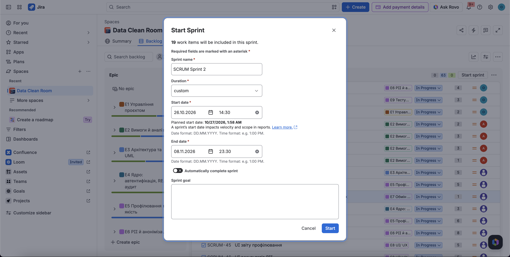
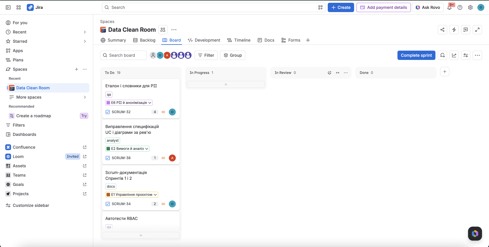

# Спринт 2: Planning, ціль, склад

Проєкт: Data Clean Room · Jira: SCRUM · Scrum-майстер: Якимчук Олексій · Product Owner: Петрунів Дмитро

## 1. Підсумок Спринта 1 (вхідні дані)

| Показник | Значення |
| --- | --- |
| Плановий період у Jira | 12.10 – 25.10.2026 |
| Закрито в Jira | 31.10.2026 (на 6 днів пізніше плану) |
| Задач у спринті / виконано | 15 / 15 |
| Story Points виконано | **49** |
| Мета спринта | Команда і процес налаштовані, працює вхід за ролями та завантаження файлу із записом в аудит. **Досягнуто.** |

Виконано за учасниками (SP): A (Якимчук) 9, B (Шибівська) 9, C (Петрунів) 6, D (Штим) 17, E (Шпіцер) 8.

Підсумки, Burndown і Retrospective Спринта 1 див. у [sprint-1.md](sprint-1.md).

## 2. Параметри Спринта 2

| Параметр | Значення                                                                                    |
| --- |---------------------------------------------------------------------------------------------|
| Дати | **31.10 – 8.11.2026**                                                                       |
| Sprint Planning | 31.10                  |
| Daily | щодня письмово в чаті                                                                       |
| Контрольна точка (Mid-sprint check) | ср 4.11, 30 хв: виконано або в рев'ю не менше 22 SP, інакше скорочуємо commit за розділом 5 |
| Backlog Refinement | ср 4.11: оцінка задач Спринта 3                                                             |
| Sprint Review + Retrospective | пт 6.11 (7–8.11 лишаються буфером)                                                          |
| Швидкість (velocity) | 49 SP за 2 тижні                                                                            |
| Обсяг зобов'язань (commit) | **56 SP**                                                                                   | |
| Загальне навантаження в Jira | **69 SP**                                                                       |

## 3. Мета Спринта 2

> Система розуміє вміст набору: показує профіль колонок, дефекти, Quality Score і PII-колонки з класом набору (Personal), працює на реальному API без mock. Аналітичні артефакти (нефункціональні вимоги, PEST/PRESTCOM, SWOT, Class Diagram) завершені.

**Що показуємо на Sprint Review (сценарій демо):**
1. Data Provider входить і завантажує `payroll.csv` (кейс 1).
2. Відкривається звіт профілювання: 500 рядків, 15 порожніх ІПН, 10 дублікатів, викиди в сумі, Quality Score.
3. Показано PII-колонки (`full_name`, `ipn`, `iban`) із типом, confidence і класом набору Personal.
4. Те саме для `customers.json` (кейс 2).
5. Правила якості (reject, flag) спрацьовують на дефектах, звіт про порушення доступний через API.

## 4. Sprint Backlog

У Jira ключі: SCRUM-32…46 (основні задачі) і SCRUM-47…50 (stretch).

Епіки в Jira: E1 SCRUM-7, E2 SCRUM-8, E3 SCRUM-9, E4 SCRUM-10, E5 SCRUM-11, E6 SCRUM-12, E7 SCRUM-13, E8 SCRUM-14, E9 SCRUM-15.

### A · Якимчук Олексій (Scrum-майстер + QA) · 9 SP (+ 4 stretch)

| Задача | SP | Епік | Мітка | Критерій приймання |
| --- | --- | --- | --- | --- |
| Еталон і словники для PII | 4 | E6 | qa | Списки українських імен, прізвищ, слів адрес. Розмічений файл: яка колонка PII і якого типу (для `payroll.csv` і `customers.json`). «Пастки»: 10-значні числа, що не є ІПН, слова, схожі на імена. За цим файлом D рахує recall і precision |
| Автотести RBAC | 3 | E9 | qa | Параметризований pytest за матрицею «ендпоінт × роль → код відповіді», працює в CI, покриває 401 і 403 та запис відмови в аудиті |
| Scrum-документація | 2 | E1 | docs | `docs/scrum/sprint-1.md` (Review, Retro, скриншоти дошки), `sprint-2.md` (Planning). Прибрано заглушки в `team-and-process.md`, імена файлів у `docs/requirements/` без суфікса `(1)`. SCRUM-4 видалено |

### B · Шибівська Ангеліна (аналітик) · 9 SP

| Задача | SP | Епік | Мітка | Критерій приймання |
| --- | --- | --- | --- | --- |
| Нефункціональні вимоги | 2 | E2 | analyst | Кожна вимога вимірювана або перевірювана: профілювання до 50 тис. рядків за узгоджений час, безпека (bcrypt, JWT), зручність, доступність |
| PEST/PRESTCOM | 3 | E2 | analyst | Таблиця 8×2 (внутрішньодержавний і міжнародний рівень), 5–7 найвагоміших чинників для SWOT |
| SWOT | 3 | E2 | analyst | Шаблон Додатку Б заповнений, письмовий висновок про стратегічні дії |
| Виправлення специфікацій і діаграми за рев'ю | 1 | E2 | analyst | Клас Personal → Confidential знижується лише коли всі PII-колонки оброблено маскуванням або узагальненням (не хешуванням). UC-13: сира версія видаляється разом з опублікованою (метадані, lineage і аудит лишаються), оновлено постумову, примітку 7 і назву. UC-02: актор лише Data Provider. Прибрано слово «пропонується» (TC-07, TC-N7) |

### C · Петрунів Дмитро (архітектор, Governance, PO) · 11 SP (+ 3 stretch)

| Задача | SP | Епік | Мітка | Критерій приймання |
| --- | --- | --- | --- | --- |
| Class Diagram | 5 | E3 | architect | Dataset, DatasetVersion, ColumnProfile, QualityRule, RuleViolation, PiiFinding, AnonymizationMethod, ExchangeRequest, LegalBasis, AuditEvent, User, Role, Policy; типи зв'язків і кратності. Узгоджено з D зі схемою БД, вихідник (draw.io або PlantUML) у `docs/` |
| Рушій правил якості і Quality Score | 5 | E5 | architect | Правила в YAML за колонками (вік 0–120, дата не з майбутнього, непорожнє значення, формат email), дії reject, flag, block. Формула Quality Score (розділ 7) записана в документації. Правила кейсів 1 і 2 спрацьовують на файлах з `data/`, зрозуміла помилка при синтаксичній помилці YAML |
| Права Data Steward і політика сирих даних | 1 | E7 | architect | `POST /datasets` повертає 403 для DataSteward, тести й TC-N6.5 оновлено. У `docs/governance` додано політику: сира версія видаляється разом з опублікованою після терміну зберігання |

### D · Штим Назар (backend) · 17 SP

| Задача | SP | Епік | Мітка | Критерій приймання |
| --- | --- | --- | --- | --- |
| Схема БД: міграції Alembic, версії, профілі, PII | 3 | E4 | backend | Alembic підключено; таблиці `dataset_versions`, `column_profiles`, `pii_findings` за узгодженою ERD; `create_all` замінено міграціями |
| Профілювання та API профілю | 6 | E5 | backend | Для кожної колонки: тип, пропуски (кількість і частка), унікальні, дублікати рядків, викиди IQR, дати з майбутнього, min/max/середнє. **На `payroll.csv`: 15 порожніх ІПН, 10 дублікатів, 13 викидів IQR; на `customers.json`: 40 порожніх міст, 15 дублікатів.** Результат зберігається в БД, є ендпоінт `GET` профілю |
| PII-детектор | 8 | E6 | backend | Regex для email, телефонів (+380…), ІПН (контрольна цифра), паспорта, IBAN (UA), карток (Луна), словники й врахування назви колонки. Для кожної колонки тип, confidence, приклад. **Recall не нижче 90% за еталоном A, мінімум хибних спрацювань.** Набір із PII отримує клас Personal. Ендпоінт `GET` результатів |

Кешування результатів профілю та PII відкладено на Спринт 3 (1 SP).

### E · Шпіцер Софія (frontend) · 10 SP (+ 6 stretch)

| Задача | SP | Епік | Мітка | Критерій приймання |
| --- | --- | --- | --- | --- |
| UI звіту профілювання | 5 | E8 | frontend | Сторінка профілю замість заглушки: таблиця колонок (тип, пропуски, дублікати), гістограми числових колонок, показник Quality Score. Працює з реальним API (`VITE_USE_MOCK=false`) |
| UI результатів PII | 5 | E8 | frontend | Таблиця колонок із типом PII і confidence, бейдж класу набору, можливість підтвердити або виправити класифікацію. Працює з реальним API |

## 5. Stretch і перенесення

**Stretch (13 SP).** Задачі вже в Спринті 2 з міткою `stretch`, але виконавець бере їх лише тоді, коли його основні задачі закрито. Порядок:

| Jira | Задача | SP | Виконавець |
| --- | --- | --- | --- |
| SCRUM-47 | Тест-кейси UC-03, UC-04, UC-05 | 4 | A |
| SCRUM-48 | Макети наступних екранів (до/після, публікація, каталог, запити) | 3 | E |
| SCRUM-49 | UI правил і порушень | 3 | E |
| SCRUM-50 | Реєстр правової підстави (таблиця `legal_basis` і API) | 3 | C |

