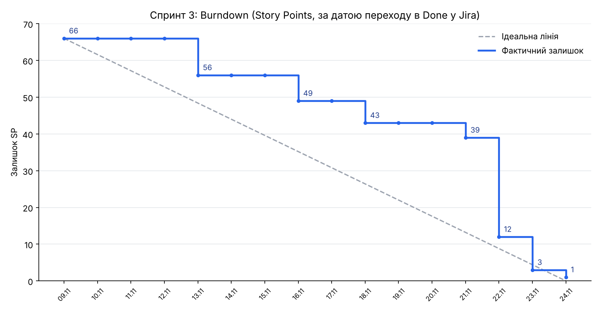
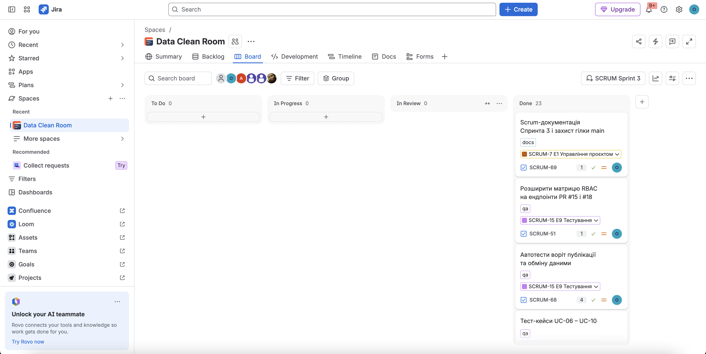

# Спринт 3: Planning, Review, Retrospective

Проєкт: Data Clean Room · Jira: SCRUM · Scrum-майстер: Якимчук Олексій · Product Owner: Петрунів Дмитро

## 1. Підсумок Спринта 2 (вхідні дані)

| Показник | Значення |
| --- | --- |
| Плановий період | 31.10 – 8.11.2026 |
| Задач у спринті / виконано | 19 / 19 |
| Story Points виконано | **69** (з них 13 SP stretch; до планового кінця — 42) |
| Velocity для планування | 49–56 SP за два тижні |

Підсумки, Burndown і Retrospective Спринта 2 див. у [sprint-2.md](sprint-2.md).

## 2. Параметри Спринта 3

| Параметр | Значення |
| --- | --- |
| Дати | **9.11 – 24.11.2026** (у Jira: старт 9.11, плановий кінець 24.11) |
| Sprint Planning | 9.11 |
| Daily | щодня письмово в чаті |
| Sprint Review + Retrospective | 24.11 |
| Обсяг зобов'язань (commit) | **57 SP** |
| Stretch | 9 SP |
| Загальне навантаження в Jira | **66 SP**, 23 задачі |

Тривалість спринта скорочено з трьох тижнів до двох із половиною, бо термін здачі проєкту зсунувся раніше. Спринт 4 планується такої самої тривалості (див. [team-and-process.md](team-and-process.md)).

## 3. Мета Спринта 3

Записана в полі Sprint goal у Jira:

> Наскрізний сценарій обміну: Provider анонімізує набір і публікує його з правовою підставою, Consumer знаходить набір у каталозі й подає запит, Steward схвалює, Consumer завантажує лише очищену версію; система перевіряє згоду, кожен крок записується в аудит. Activity, Sequence діаграми й матриця Захмана готові.

Під час спринта Product Owner уточнив мету: запит схвалює **власник набору (Data Provider)**, а не Data Steward (UC-09). Steward бачить запити лише для читання.

**Сценарій демо на Sprint Review** (TC-E2E.1 у [test-cases-uc06-uc10.md](../testing/test-cases-uc06-uc10.md)):
1. Data Provider завантажує `payroll.csv`, бачить профіль і PII-колонки.
2. Анонімізація «до/після»: `full_name` і `iban` — маскування, `ipn` — HMAC.
3. Перевірка воріт публікації, внесення правової підстави і терміну зберігання, публікація.
4. Data Consumer знаходить набір у каталозі й подає запит з метою.
5. Provider схвалює запит. Система перевіряє правову підставу.
6. Consumer завантажує очищену версію, у файлі немає сирих PII.
7. Журнал аудиту показує всі кроки. Після відкликання згоди (UC-14) повторне схвалення і завантаження блокуються.

## 4. Sprint Backlog

Ключі в Jira: SCRUM-51…73. SCRUM-51…53 перенесено з Backlog Refinement Спринта 2, решту створено на Planning 9.11. Для кожної задачі в коментарях Jira вказано, які задачі мають бути виконані перед нею.

### A · Якимчук Олексій (Scrum-майстер + QA) · 10 SP

| Jira | Задача | SP | Епік | Критерій приймання |
| --- | --- | --- | --- | --- |
| SCRUM-51 | Розширити матрицю RBAC на нові ендпоінти | 1 | E9 | Ендпоінти профілю, PII, правової підстави, анонімізації, публікації та обміну в матриці «роль → код», включно з чужим Provider (404) |
| SCRUM-67 | Тест-кейси UC-06 – UC-10 | 4 | E9 | Позитивні, негативні та E2E-кейси за шаблоном, зв'язок з автотестами, перелік розбіжностей із специфікаціями |
| SCRUM-68 | Автотести воріт публікації та обміну даними | 4 | E9 | Негативні сценарії обміну, наскрізний сценарій, аудит кожного кроку |
| SCRUM-69 | Scrum-документація Спринта 3 і захист гілки `main` | 1 | E1 | Цей документ, нотатки зустрічей, захист `main`, дати спринтів у `team-and-process.md` |

### B · Шибівська Ангеліна (аналітик) · 7 SP (+ 2 stretch)

| Jira | Задача | SP | Епік | Критерій приймання |
| --- | --- | --- | --- | --- |
| SCRUM-64 | Activity Diagrams: обмін даними; анонімізація і публікація | 4 | E3 | Дві діаграми з розгалуженнями (немає підстави, відхилення, відкликання), вихідники в `docs/` |
| SCRUM-65 | Оновити специфікації UC-07 – UC-10 під управління згодою (варіант B) | 2 | E2 | Мета, термін дії і відкликання підстави в передумовах і альтернативних потоках |
| SCRUM-66 | Обґрунтування вибору аспектів data governance | 1 | E7 | Пріоритети аспектів з обґрунтуванням для DCR |
| SCRUM-72 | Словник даних для каталогу (stretch) | 2 | E7 | Поля картки набору (UC-12) і словник колонок очищених `payroll.csv` і `customers.json` |

### C · Петрунів Дмитро (архітектор, Governance, PO) · 14 SP (+ 2 stretch)

| Jira | Задача | SP | Епік | Критерій приймання |
| --- | --- | --- | --- | --- |
| SCRUM-57 | Ворота публікації і перерахунок класу набору (UC-07) | 4 | E7 | Публікація лише за умов governance 3.5, причини відмови, перерахунок класу, `DENY` в аудиті |
| SCRUM-58 | Управління згодою: мета, термін дії, відкликання (варіант B) | 4 | E7 | Поля мети і чинності, відкликання (UC-14), перевірка підстави на схваленні та завантаженні |
| SCRUM-59 | Sequence Diagram (обмін, публікація) і оновлення Class Diagram | 3 | E3 | Дві діаграми послідовності, Class Diagram відповідає моделі |
| SCRUM-60 | Матриця Захмана 6×6 | 3 | E3 | Усі 36 клітинок заповнено для DCR |
| SCRUM-71 | Component і Deployment Diagram (stretch) | 2 | E3 | Компоненти і розгортання за `docker-compose.yml` |

### D · Штим Назар (backend) · 15 SP (+ 4 stretch)

| Jira | Задача | SP | Епік | Критерій приймання |
| --- | --- | --- | --- | --- |
| SCRUM-52 | [Bug] Consumer бачить неопубліковані набори | 1 | E4 | `GET /datasets` для Consumer лише `published`, `xfail` знято |
| SCRUM-54 | Alembic і версії наборів (`dataset_versions`) | 3 | E4 | Міграції замість `create_all`, сира і чиста версії набору |
| SCRUM-55 | Анонімізація PII-колонок і API (UC-06) | 6 | E6 | `mask`, `generalize`, `hmac`; preview і застосування; чиста версія; аудит `ANONYMIZE` |
| SCRUM-56 | API запитів на обмін (UC-08 – UC-10) | 5 | E7 | Створення, схвалення/відхилення власником, завантаження лише очищеної версії, перевірка підстави, аудит |
| SCRUM-53 | API правил якості і порушень (stretch) | 2 | E5 | Ендпоінти правил і порушень для екрана SCRUM-49 |
| SCRUM-70 | `future_dates_count` і події `PII_SCAN` / `VIEW_PII` (stretch) | 2 | E5 | Показник у профілі, події в аудиті |

### E · Шпіцер Софія (frontend) · 11 SP (+ 1 stretch)

| Jira | Задача | SP | Епік | Критерій приймання |
| --- | --- | --- | --- | --- |
| SCRUM-61 | UI анонімізації «до/після» (UC-06) | 4 | E8 | Вибір методу для PII-колонок, попередній перегляд, застосування на реальному API |
| SCRUM-62 | UI публікації з правовою підставою (UC-07) | 3 | E8 | Чек-лист воріт, причини відмови, внесення підстави і терміну зберігання |
| SCRUM-63 | UI каталогу, запитів і відкликання згоди (UC-08 – UC-10, UC-12) | 4 | E8 | Каталог для Consumer, запит з метою, схвалення власником, завантаження, відкликання |
| SCRUM-73 | Підключити UI правил і порушень до API (stretch) | 1 | E8 | Екран SCRUM-49 працює без mock |

## 5. Результати Спринта 3

Дані з Jira (дата переходу задачі в Done).

| Jira | Задача | Виконавець | SP | Done | PR |
| --- | --- | --- | --- | --- | --- |
| SCRUM-51 | Розширити матрицю RBAC | A | 1 | 23.11 | #48 |
| SCRUM-52 | [Bug] Consumer бачить неопубліковані набори | D | 1 | 22.11 | #43 |
| SCRUM-53 | API правил якості і порушень (stretch) | D | 2 | 22.11 | #43 |
| SCRUM-54 | Alembic і версії наборів | D | 3 | 22.11 | #43 |
| SCRUM-55 | Анонімізація PII-колонок і API | D | 6 | 22.11 | #43 |
| SCRUM-56 | API запитів на обмін | D | 5 | 22.11 | #43 |
| SCRUM-57 | Ворота публікації і перерахунок класу | C | 4 | 13.11 | #45 (злито 22.11) |
| SCRUM-58 | Управління згодою (варіант B) | C | 4 | 13.11 | #29, #30 (злито 18.11) |
| SCRUM-59 | Sequence Diagram і Class Diagram | C | 3 | 18.11 | #28 |
| SCRUM-60 | Матриця Захмана | C | 3 | 18.11 | #35 |
| SCRUM-61 | UI анонімізації «до/після» | E | 4 | 21.11 | #41 |
| SCRUM-62 | UI публікації з правовою підставою | E | 3 | 22.11 | #42 |
| SCRUM-63 | UI каталогу, запитів і відкликання | E | 4 | 22.11 | #44 |
| SCRUM-64 | Activity Diagrams | B | 4 | 16.11 | #36 |
| SCRUM-65 | Специфікації UC-07 – UC-10 (варіант B) | B | 2 | 16.11 | #38 |
| SCRUM-66 | Аспекти data governance | B | 1 | 16.11 | #39 |
| SCRUM-67 | Тест-кейси UC-06 – UC-10 | A | 4 | 23.11 | #47 |
| SCRUM-68 | Автотести воріт публікації та обміну | A | 4 | 23.11 | #48 |
| SCRUM-69 | Scrum-документація Спринта 3 | A | 1 | цей PR | — |
| SCRUM-70 | `future_dates_count`, `PII_SCAN` / `VIEW_PII` (stretch) | D | 2 | 22.11 | #43 |
| SCRUM-71 | Component і Deployment Diagram (stretch) | C | 2 | 13.11 | #31 (злито 18.11) |
| SCRUM-72 | Словник даних (stretch) | B | 2 | 24.11 | #40 |
| SCRUM-73 | UI правил і порушень на API (stretch) | E | 1 | 22.11 | #46 |

Підсумок за учасниками (SP): A 10, B 7 (+2 stretch), C 14 (+2 stretch), D 15 (+4 stretch), E 11 (+1 stretch). До планового кінця 24.11 виконано **65 з 66 SP** (22 з 23 задач); SCRUM-69 закривається цим PR.

## 6. Sprint Review

**Мету спринта досягнуто** з уточненням про того, хто схвалює запит (розділ 3). Оцінку підтверджує Product Owner на Review.

Що показано (інкремент у `main` станом на 24.11):
- анонімізація PII-колонок (`mask`, `generalize`, `hmac`) з попереднім переглядом і чистою версією набору, UI «до/після»;
- Alembic-міграції і версії наборів (сира і чиста);
- ворота публікації з причинами відмови і перерахунком класу (Internal / Confidential / Personal), UI публікації з чек-листом;
- реєстр правової підстави з метою, терміном дії і відкликанням (UC-14);
- каталог для Consumer, запит з метою, схвалення або відхилення власником з перевіркою підстави, завантаження лише очищеної версії, UI цих сценаріїв;
- API і UI правил якості та порушень на реальних даних;
- Activity, Sequence, Component і Deployment діаграми, оновлена Class Diagram, матриця Захмана, словник даних, обґрунтування аспектів governance;
- 45 тест-кейсів UC-06 – UC-10 (44 автоматизовано), RBAC-матриця на 5 ролей і 18 ресурсних ендпоінтів, наскрізний автотест на `customers.json`. Усього в CI 402 автотести і 1 `xfail` (відомий дефект SCRUM-74).

Відомі дефекти й розбіжності, перенесені в Спринт 4:

| Що | Де зафіксовано | Відповідальний |
| --- | --- | --- |
| Повторне завантаження очищеного набору повертає 403 (UC-10, AC2) | SCRUM-74 | D |
| Каталог показує Quality Score у 100 разів більшим | SCRUM-75 (PR #49 у рев'ю) | E |
| `pd.read_json` читає `phone` як число, `+380` губиться при маскуванні | словник даних, відкрите питання 6; задачу ще не заведено | D |
| Reject-рядки не відкидаються з очищеної версії (500 замість 484) | `test-cases-uc06-uc10.md`, розбіжність 3 | рішення PO |
| Анонімізацію можна запустити після публікації | там само, розбіжність 1 | рішення PO |
| Дубльований запит і 404 на `approve`/`reject` не пишуться в аудит | там само, розбіжність 5; `rbac-matrix.md` | рішення PO |

## 7. Burndown

Залишок SP за датою переходу задачі в Done у Jira (66 SP на старті):

| Дата | 9.11 – 12.11 | 13.11 | 16.11 | 18.11 | 21.11 | 22.11 | 23.11 | 24.11 |
| --- | --- | --- | --- | --- | --- | --- | --- | --- |
| Залишок SP | 66 | 56 | 49 | 43 | 39 | 12 | 3 | 1 |

Аналітичні й архітектурні задачі закривалися рівномірно з 13.11 по 18.11. Увесь backend і frontend (34 SP) перейшов у Done 21–22.11, за 2–3 дні до кінця спринта: 27 SP закрито за один день 22.11. Ідеальну лінію фактичний залишок перетнув лише 23.11.

Застереження до даних: SCRUM-57, 58 і 71 переведено в Done 13.11, а їхні PR злито 18.11 і 22.11. Якщо рахувати за датою злиття, до 18.11 залишок був би на 10 SP більшим.

## 8. Velocity

| Спринт | Заплановано (commit / всього) | Виконано до планового кінця | Виконано всього |
| --- | --- | --- | --- |
| 1 | 49 | — | 49 (закрито на 6 днів пізніше) |
| 2 | 56 / 69 | 42 | 69 (з 13 SP stretch) |
| 3 | 57 / 66 | **65** | 66 (з 9 SP stretch) |

Уперше майже весь обсяг виконано до планового кінця. Для Спринта 4 беремо velocity **55–60 SP**. Спринт 4 зосереджений на стабілізації, звіті й захисті, тому частина ємності йде на документи, а не на код.

## 9. Знімки дошки

## 10. Retrospective

**Виконання дій з ретро Спринта 2**

| Дія | Результат |
| --- | --- |
| Один PR на одну задачу, ключ Jira в назві | Частково. PR #43 об'єднав 6 задач backend без ключа в назві; #48 об'єднав SCRUM-51 і 68; #29 має ключ SCRUM-57, хоча реалізує SCRUM-58 |
| Done лише після злиття PR | Частково. SCRUM-57, 58, 71 у Done 13.11, PR злито 18.11 і 22.11. Решта задач — після злиття |
| Захист гілки `main` | Не виконано в спринті, закривається в SCRUM-69 |
| Мета спринта в Jira | Виконано |
| Контракт API до початку UI | Не виконано: frontend підлаштовувався під backend після злиття |
| Alembic і `dataset_versions` на початку спринта | Не виконано: злито 21.11 разом з рештою backend |

**Що пішло добре**
- Мету спринта досягнуто: наскрізний сценарій обміну працює в `main` і закріплений автотестом.
- 65 з 66 SP виконано до планового кінця, уперше без запізнення.
- Аналітичні й архітектурні задачі (B, C) закрито за перший тиждень, вони стали основою для специфікацій і тестів.
- Рев'ю знаходили реальні дефекти до злиття (хто схвалює запит, коди 403/404, назви подій аудиту, формати масок у словнику).
- Тест-кейси й автотести виявили розбіжності між кодом і специфікаціями (SCRUM-74, SCRUM-75, обробка reject-рядків, `phone`).

**Що не пішло**
- Backend і frontend злито за 2–3 дні до кінця спринта, тож на інтеграцію, рев'ю й тести лишилося дуже мало часу.
- Великий PR #43 (17 комітів, 6 задач) важко рев'юїти.
- Закриті PR #32 і #33 реалізували чужі задачі, що спричинило дублювання й конфлікти з роботою backend.
- Контракт API не узгодили заздалегідь, і UI переробляли під фактичні відповіді.
- Задачі переходили в Done до злиття PR.
- У Jira-описах задач спершу було написано, що запит схвалює Steward. Це суперечило UC-09, і код довелося виправляти.

**Що змінюємо в Спринті 4**

| Дія | Відповідальний |
| --- | --- |
| Захист `main`: лише PR з одним апрувом і зеленим CI (без цього злиття неможливе) | A |
| Один PR на задачу; PR більше ~400 рядків діляться | усі |
| Задачу бере той, на кого вона призначена; зміни в чужій задачі — лише після домовленості | усі, контроль C |
| Контракт API (шлях, тіло, коди, приклади) фіксується в описі задачі до початку UI | C, D, E |
| Перший PR кожної кодової задачі — до середини спринта; на контрольній точці рахуємо злиті PR | A |
| Done лише після злиття; A перевіряє на кожному Daily | A |
| Описи задач у Jira звіряти зі специфікаціями UC перед Planning | A, B |
